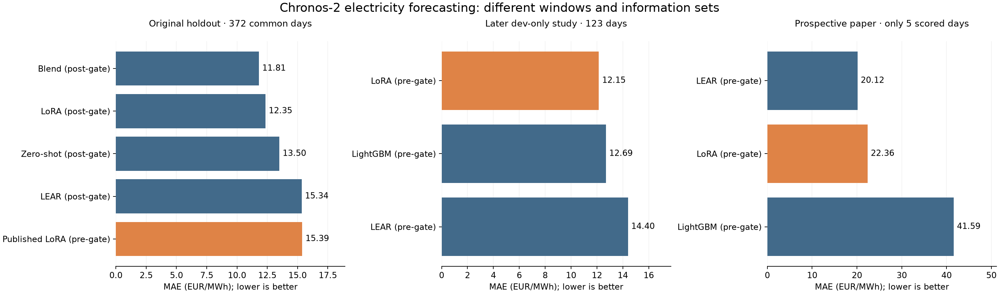

# Chronos-2 for German day-ahead electricity prices

[Model weights on Hugging Face](https://huggingface.co/AryanSudhirDev/chronos-2-de-lu-pregate) ·
[Results](docs/RESULTS.md) · [Method](docs/METHODOLOGY.md) ·
[Reproduction](docs/REPRODUCIBILITY.md) · [Data and inputs](docs/DATA.md)

A research project by **Aryan Sudhir** testing whether adapting a time-series foundation model
improves forecasts of the next day's 24 hourly German/Luxembourg electricity prices.
The release includes the forecasting code, tests, recorded experiment ledger, saved model
forecasts, evaluation summaries, and a standalone fine-tuned Chronos-2 checkpoint.

**What we achieved:** with post-auction wind/solar inputs, the best compact blend reached
**11.81 EUR/MWh MAE** on a common 372-day holdout, a **23.0% reduction against LEAR**.
Fine-tuned Chronos-2 alone reached **12.35**, an **8.5% reduction against zero-shot Chronos-2**.
Those inputs arrive after the auction deadline. The published model, used with pre-auction
weather-derived inputs, scored **15.39** and did **not** establish a holdout improvement
over the original LEAR benchmark. The result supports fine-tuning under the research information
set; it does not establish a live trading edge.

## What's published

| Location | Contents |
|---|---|
| [Hugging Face](https://huggingface.co/AryanSudhirDev/chronos-2-de-lu-pregate) | Full merged weights, original LoRA adapter, calibration, inference helper, synthetic example, documentation and source archive |
| `src/epf/` | Panel construction, causal features, LEAR, metrics, blending, process isolation, battery simulation and paper safeguards |
| `scripts/` | Public-feed collection, weather preprocessing, baselines, zero-shot, LoRA/full tuning, stacking and evaluation |
| `publish/` | Portable inference, model card and source-release tooling |
| `tests/` | Synthetic tests for causality, isolation, dispatch constraints, immutable issuance and release input validation |
| `runs/ledger.jsonl` | Original 47 append-only records representing 46 unique recorded trial IDs |
| `runs/forecasts/` | Saved predictions for recorded trials; no raw market feed archive |
| `runs/holdout_summary.json` | Seven-model comparison on the identical 372 delivery days |
| `runs/readiness/`, `runs/adaptive/`, `runs/replay/`, `runs/paper/` | Selected frozen protocols and reports for subsequent diagnostics |
| `docs/` | Results, process, data schema, limitations, artifact map and reproduction guide |

## Run the released model

Python **3.12** is required for this research environment. The tested export stack is pinned in
`requirements-inference.txt`; `requirements-research.txt` pins the direct research dependencies.

```sh
git clone https://github.com/AryanSudhirDev/chronos-2-de-lu-pregate.git
cd chronos-2-de-lu-pregate
uv venv --python 3.12
uv pip install -r requirements-inference.txt
.venv/bin/hf download AryanSudhirDev/chronos-2-de-lu-pregate --local-dir model
.venv/bin/python scripts/make_example_input.py --output example_input.json
.venv/bin/python publish/inference.py --model model --input example_input.json --output forecast.json --calibration model/calibration.json
```

The example is **synthetic**: it checks the schema and inference path, not forecast accuracy.
The model returns 24 hourly median predictions, all quantiles, and optional calibrated 80%
intervals. CPU is the default; pass `--device mps` on a compatible Mac.
For actual inputs, follow [the units, timestamps and availability rules](docs/DATA.md).
No account or token is required to download the public release.

## Results at a glance

The original holdout covers 2025-11-01 through 2026-11-09. All seven rows below use the
same 372 days; two pre-gate forecasts were missing. Lower MAE is better.

| Model / input setup | MAE EUR/MWh | Interpretation |
|---|---:|---|
| Compact Chronos + stack + LightGBM blend | 11.81 | Post-auction research inputs |
| LightGBM correction on fine-tuned Chronos | 11.97 | Post-auction research inputs |
| LoRA Chronos-2 | 12.35 | Post-auction research inputs |
| Zero-shot Chronos-2 | 13.50 | Post-auction research inputs |
| LEAR | 15.34 | Original post-auction reference |
| **Published LoRA, pre-auction inputs** | **15.39** | No established gain over the original LEAR reference |
| LightGBM | 15.49 | Original post-auction reference |

The published checkpoint and research LoRA share the retained fit; supplying different
future wind/solar inputs changes their measured accuracy. The blend and correction model are
additional components, not baked into the published neural weights.

On a later **development-only** 123-day pre-gate comparison, LoRA scored **12.15**, LightGBM
**12.69**, and LEAR **14.40**. Interval calibration raised observed coverage from **71.1% to
83.6%**. These are development results after the original study, not another untouched test.
The separate prospective paper stream stopped at **five scored days**, with LoRA MAE **22.36**
versus LEAR **20.12**. It did not complete the planned 30-day observation.

Read [RESULTS.md](docs/RESULTS.md) for windows, uncertainty, statistical tests, failed experiments
and cost sensitivity. Saved numeric artifacts take precedence over rounded prose.



## How the project developed

1. The initial question concerned crypto returns. The implemented study moved to electricity
   prices, where load, renewables and neighbouring markets provide an explicit information set.
2. We assembled hourly public data, normalized Berlin delivery days and defined time-ordered
   development folds and a final holdout.
3. We established naive, LEAR and LightGBM references, then tested Chronos-2 zero-shot with
   alternative covariates and context lengths.
4. We trained LoRA and full fine-tuning variants, using a later validation block, then tested
   LightGBM residual correction and small blends.
5. We identified the post-auction timing issue and built a pre-auction weather-derived track.
6. Before the holdout opening, we implemented offline OS-isolated workers, tested them on
   synthetic/development inputs and persisted each prediction before revealing its outcome.
7. We opened the holdout once for three declared candidates and four references, then examined
   readiness, costs, calibration and one adaptive correction on separately labelled streams.
8. We froze the retained adapter and calibration for prospective paper observation. All queues
   were stopped at the user's request on 2026-11-15. Publishing has not resumed those jobs.

## Reproduce and inspect

```sh
uv pip install -r requirements-research.txt
uv pip install --no-deps -e .
.venv/bin/python -m unittest discover -s tests -v
```

Core data processing and released inference are portable. The historical offline evaluation
and several tests require **macOS `/usr/bin/sandbox-exec`** and an editable environment at
`.venv/`. No equivalent Linux sandbox is claimed. The original machine was an Apple M4 Pro
with 24 GB unified memory; heavy models ran one at a time.

Start with [REPRODUCIBILITY.md](docs/REPRODUCIBILITY.md). It distinguishes loading the exact
weights, rebuilding data, rerunning development experiments and inspecting the already-opened
holdout. Current feeds can be revised; retraining is not promised to reproduce weights bit for bit.

## Limitations and scope

The base model's pretraining cutoff and possible overlap with evaluation data remain unverified.
Historical source publication vintages are not fully established. Daily Diebold-Mariano tests
are not corrected for serial dependence or selection across research trials. Lower forecast error
does not imply profitable dispatch. Battery examples use assumed costs and omit material execution
and asset risks. Hourly averages do not reproduce trading in 15-minute products. Nothing places
orders, bids or trades.

## License and attribution

Code and the released derivative model are shared under **Apache-2.0**; see `LICENSE` and
`NOTICE`. The base model is [Amazon Chronos-2](https://huggingface.co/amazon/chronos-2).
Raw third-party data is not included; its source terms remain separate. See
[DATA.md](docs/DATA.md) and [CITATION.cff](CITATION.cff).
